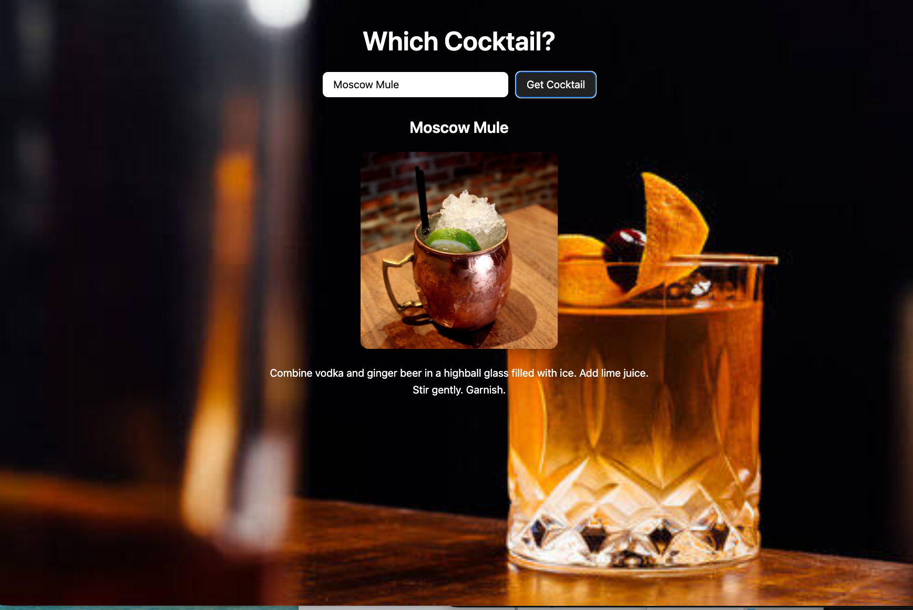

# ☀️ Bar Drinks Image
Use this program if you want to view more info about a specific bar drink!

# Link
[Check out the Site!](https://bardrinksbyje.netlify.app/)

# 📋 How to use
1. Open the app in your browser
2. Click, get info
3. Instantly view drink info

# 📷 Images

# 📋 How to use
1. Open the app in your browser  
2. Enter a Bar Drink
3. Instantly view more information about the drink

# ✨ Features
* Responsive design for desktop and mobile.         
* Interactive user interface.   
* Client-server communication using the Fetch API.    
* Dynamic content updates without reloading the page.    
* JSON-based API responses.   

# 🔨 Built With
* HTML5 – structure    
* CSS3 – responsive design and background   
* JavaScript - fetch information from backend   

# 🧠 What I Learned
* How to create an HTTP server using Node.js without Express.   
* How to implement API endpoints and handle HTTP requests.    
* How to use the Fetch API to retrieve backend data.   
* How to send and receive JSON data.   
* How to dynamically update the DOM using JavaScript.   
* How to serve static files such as CSS, JavaScript, and images.     
